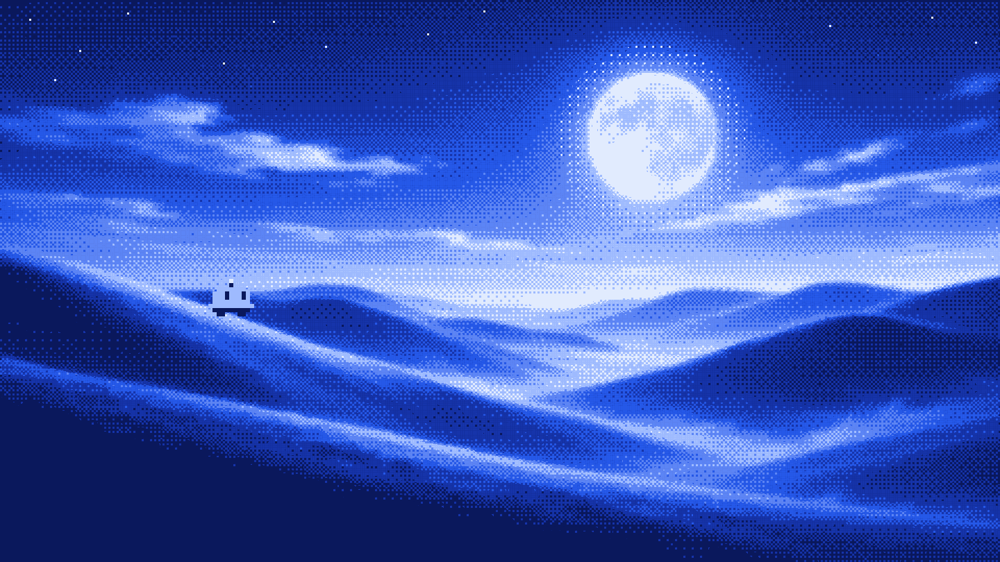

# selene-lua

Um tema para o Claude Code nos apps de desktop e celular: os sete azuis do mundo da lua da Selene, com a lua cheia pontilhada sobre as dunas atrás da conversa, estrelas que piscam e um mascote na duna.



## O que ele muda

- **Cores:** a interface inteira passa a usar os sete azuis da imagem, nos modos claro e escuro. O destaque é o azul elétrico `#2558e8`.
- **Fundo:** a paisagem da lua aparece atrás da conversa, com os painéis translúcidos por cima. No celular, o fundo é um recorte em pé, com a lua maior.
- **Movimento:** as estrelas piscam, um halo de pontos pulsa em volta da lua e uma estrela cadente passa de vez em quando.
- **Mascote:** um bichinho em pixel art fica numa duna e faz uma coisa em cada parte do dia. É um desenho original, não o mascote oficial do Claude.

| Horário | Mascote |
| --- | --- |
| Madrugada (0h–5h) | dorme, com "z" subindo |
| Manhã (5h–12h) | pula no lugar |
| Tarde (12h–18h) | anda pela crista da duna e volta |
| Noite (18h–24h) | fica olhando para a lua e pisca |

As sete cores, da mais escura à mais clara:

`#0a185c` `#1634aa` `#2558e8` `#5c86f6` `#a0bcff` `#e2ebff` `#fafcff`

## O que esperar

- O tema só aparece nos apps de desktop e celular. O terminal e os editores não desenham temas.
- O tema é de cada sessão: um chat ganha a lua depois que a primeira mensagem inicia a sessão dele.
- O app decide se o fundo pode se mexer. Com a redução de movimento do sistema ligada, ou sem aceleração de vídeo, ele congela a paisagem, e o mascote aparece parado na pose da hora.
- É preciso uma versão do Claude Code com suporte a temas. Numa versão anterior, o mod carrega e não pinta nada.

## Instalar

No app de desktop: clique em **+** ao lado da caixa de mensagem, depois em **Plugins**, **Add marketplace** com `Orneryy/Selene-mod-claude`, e então **Add plugin**.

No prompt de uma sessão do Claude Code no terminal:

```
/plugin install selene-lua --marketplace Orneryy/Selene-mod-claude
```

Ou direto do shell:

```
claude plugin install selene-lua --marketplace Orneryy/Selene-mod-claude
```

O Claude Code pergunta se pode adicionar o marketplace (responda `y`) e depois em qual escopo instalar (Enter aceita o escopo de usuário). Instalado no escopo de usuário, o tema carrega em toda sessão nova, inclusive nas do app de desktop.

## Atualizar

Quem já instalou pega a versão nova com:

```
claude plugin update selene-lua@selene-mod-claude
```

A atualização vale para as sessões iniciadas depois dela.

## Ajustar

- As cores ficam em `hooks/register.tsx`.
- O quanto os painéis cobrem a paisagem é o `opacity` de `backdrop.glass`, no mesmo arquivo: um valor menor mostra mais a imagem, um maior deixa o texto mais firme.
- O que se mexe fica em `hooks/vida.ts`: as estrelas, o halo, a estrela cadente e o mascote.
- `hooks/scene.ts` é gerado e não deve ser editado à mão. A paisagem vai como vetor puro, sem imagem embutida: o pontilhado é refeito por 96 regiões, cada uma preenchida por um padrão que pinta uma das 16 células de um ladrilho 4 × 4 em um dos tons.
